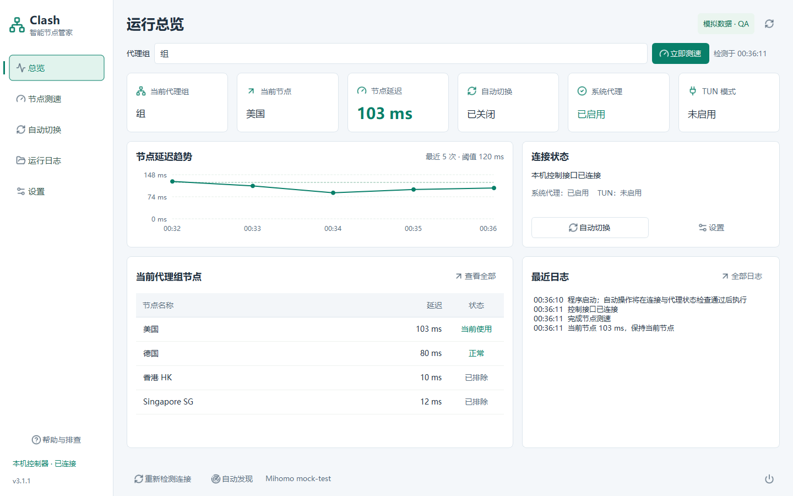

# Clash 智能节点管家

Python + PySide6 开发的独立 Windows 桌面工具，使用 Mihomo 官方本机控制 API。仅在选定代理组内测速并自动切换，不改动 Clash Verge 的系统代理、TUN、路由模式或订阅。

## 直接运行

当前版本为 **3.1.1 UI 修复**，修正图标裁切、未测速与提示框对齐，并统一控件尺寸和间距。
实际验证见 [UI 验证记录](docs/UI_VERIFICATION.md)。3.0.0 多轮运行原生崩溃的
复现与修复验证见 [稳定性记录](docs/STABILITY.md)，本地修复包由当前源码重新构建。

从 [V3.1.1 Release](https://github.com/gzl1234567890/ClashSmartSwitcher/releases/tag/v3.1.1) 下载 `ClashSmartSwitcher-3.1.1-windows-x64.zip`。先从托盘退出旧程序，再解压到新目录并双击 `ClashSmartSwitcher.exe`，请保留同目录的 `_internal` 文件夹，不要只复制 EXE。分发包自带 Python 与 Qt，使用者不需要安装 Python。

1. 先运行 Clash Verge。
2. 软件启动后尝试自动连接；未连接时点击“自动发现”。
3. 从“代理组”选择要管理的 Selector 组，先点击“立即测速”。此操作不切换节点。
4. 在 Clash Verge 中启用系统代理或 TUN，进入“自动切换”页，再点击“开启自动切换”。
5. 使用“暂停”或“关闭”停止自动操作；窗口默认关闭到托盘，真正退出请点击“退出”。

控制接口未连接时，在“连接与设置”填写本机控制地址和密钥并保存。不要填写代理流量端口。详细步骤见软件内“帮助与排查”，或 [连接指南](docs/HELP.md)。

## 页面与后台反馈

- 总览：当前组、节点与代理状态、最近 5 次延迟趋势、前 5 个节点摘要和最近日志。
- 节点测速：完整节点表、搜索、检测时间及测速结果；“立即测速”不会切换节点。
- 自动切换：开启、暂停、关闭、规则摘要和本次运行的切换记录；“编辑规则”定位到设置。
- 运行日志：完整运行反馈，可跟随最新、清空显示或打开日志目录。
- 设置：连接、测速规则、排除地区、并发及应用选项。

切换页面不会重启后台任务。自动切换成功和监测异常均不弹出系统通知或阻塞对话框；异常显示在界面和日志中，可重新检测连接。异常暂停、重试和主动退出时的确认机制继续生效。

自动切换运行中仍可编辑并保存设置，新的测速与切换规则从下一轮检测生效。未保存的编辑不会改变运行规则或被后台结果覆盖；“立即测速”使用已应用的规则。保存控制地址或密钥时，会先结束当前任务并重新连接，验证通过后恢复原先的自动运行状态。“重新检测连接”和“自动发现”也保留原运行状态；连接失败、代理状态不满足条件或用户主动暂停时不恢复自动切换。

## 默认规则

| 参数 | 默认值 |
|---|---|
| 检测间隔 | 60 秒，首次开启立即检测 |
| 延迟阈值 | 120 ms，等于阈值时保持 |
| 单节点测速超时 | 5000 ms |
| 排除地区 | 默认香港、新加坡；候选地区随当前代理组更新，支持搜索、多选、删除和清空 |
| 测速地址 | https://www.gstatic.com/generate_204 |
| 并发测速 | 自动模式最多 8 个，可手动调整 |
| 最小切换间隔 | 60 秒，可设为 0 |

全部可在设置中更改并保存。当前节点超过阈值或测速失败时，选择当前组内延迟最低的成功测速且未被排除的服务器。候选仍超过阈值也允许切换，并显示高延迟提示。当前已最低不重复切换。每轮最多一次，写请求不重试，切换后读取实际节点验证。

测速与接口请求在后台线程中运行。自动测速最多同时探测 8 个节点，避免大量节点互相争抢连接；短超时遇到 Mihomo 504 时会以 5 秒预算重试一次。检测轮次不重叠；暂停会阻止后续测速和切换，已经提交的请求不能撤回。测速期间检测到手动换节点时，本轮取消自动切换。

## 连接与兼容范围

- 目标平台：Windows 10/11 x64；实际构建和验证平台为 Windows 11，系统版本 10.0.26200。
- 本机已识别 Clash Verge Rev **2.5.8**，Mihomo **v1.19.32**。已验证真实接口读取版本、代理组与当前选择、实时 TUN 与网卡状态；真实测速结果和具体测试数量见 [验证报告](docs/VERIFICATION.md)。
- 官方命名管道承载标准 HTTP，不使用应用私有 IPC。自动发现仅读取三个已知 AppData 配置目录，并匹配同一用户标识的官方 Mihomo 活动管道。HTTP/HTTPS 也只接受回环地址，忽略环境代理并拒绝重定向。
- 当前只管理可控 Selector 的直接服务器成员；不递归展开嵌套代理组，不跨组测速。当前选中嵌套组时只测速并提示，不执行自动切换。URLTest、Fallback 等组继续由内核管理。
- 规则模式可能使用多个组，程序不能可靠推断一个“当前组”，由用户选择。其他组不自动跟随。
- 系统代理须指向当前内核 HTTP/混合端口；PAC 或其他软件代理显示无法确认。TUN 需实时 API 开启且对应网卡活动。两者均未可靠确认时阻止自动切换。
- 单次测速失败无法可靠区分节点故障与测速网站不可达。程序显示不确定性，所有候选失败不切换。
- 为保护正在使用的网络，开发测试未对真实代理组发送切换请求；成功、失败、未生效、手动变更等切换场景使用模拟接口验证。真实切换请按 [手动验收清单](docs/MANUAL_TESTS.md) 测试。
- 未在所有 Clash Verge 版本、Windows 10 实机或其他电脑上验证；不能保证所有版本的 IPC、TUN 网卡命名都兼容。无可用官方管道时请在 Clash Verge 中手动启用本机 HTTP 控制器。

## 配置、安全与日志

配置位于 `%LOCALAPPDATA%\ClashSmartSwitcher\settings.json`，日志位于同目录 `logs`。密钥使用 Windows DPAPI 绑定当前账户加密，或选择仅本次使用。不把真实密钥写入源码、发布包或普通日志。配置损坏自动备份并恢复默认值。日志滚动保留最多约 10 MB；界面“清空显示”不删除文件日志。

不要求管理员权限，不开启外部端口，不修改代理设置，不上传节点、订阅、日志或密钥。控制器仅支持本机地址；不要把 Clash 控制接口暴露到局域网或公网。

## 开发环境

本项目已创建专用 Conda 环境，目录名为 **clash-smart-switcher**：

```powershell
conda activate D:\Ai_Coding\ClashSmartSwitcher\.conda\clash-smart-switcher
python main.py
```

这是通过 `--prefix` 创建的项目内环境，激活请使用完整路径。另一个工作区可重建：

```powershell
conda create --prefix .\.conda\clash-smart-switcher python=3.12 pip -y
.\.conda\clash-smart-switcher\python.exe -m pip install -r requirements-dev.txt
.\.conda\clash-smart-switcher\python.exe -m pytest -q
```

为减少不必要组件，依赖 PySide6 Essentials，它提供本软件所需的 Qt Widgets、Qt Network 与 Qt GUI。完整 PySide6 中的 QML、WebEngine 等组件未使用。

## 构建

在 Windows x64 中双击 `build.bat`，或在终端执行它。脚本按 `requirements-build.txt` 锁定的依赖安装、生成 400／500／600 静态字体、运行测试、生成 Qt 标准电脑图标、调用 PyInstaller、执行打包后冒烟测试、生成便携 ZIP。可用项目 Conda 环境或系统 Python 3.12+，本轮验证为 Python 3.12。fontTools 仅用于开发时生成字体，不是运行依赖；字体许可证随发布包保留。

```powershell
.\.conda\clash-smart-switcher\python.exe scripts\make_static_fonts.py
.\.conda\clash-smart-switcher\python.exe scripts\make_icon.py
.\.conda\clash-smart-switcher\python.exe -m PyInstaller --noconfirm --clean ClashSmartSwitcher.spec
.\.conda\clash-smart-switcher\python.exe scripts\package_release.py
```

输出：`dist\ClashSmartSwitcher\ClashSmartSwitcher.exe`、`dist\ClashSmartSwitcher-3.1.1-windows-x64.zip` 及 `.zip.sha256` 校验文件。程序未做商业代码签名，Windows 可能显示“未知发布者”；请核对来源及 SHA256。构建脚本只打包程序、允许列表中的说明和许可证，不打包开发测试数据、个人配置、Conda 环境或运行日志。

## 项目结构

```text
main.py                       应用入口、单实例与无网络启动检查
smart_switcher/
  api.py, discovery.py        本机 HTTP / 命名管道通信与发现
  core.py, monitor.py         单组决策、后台测速、定时与取消
  config.py, status.py        配置、DPAPI 与代理/TUN 门禁
  diagnostics.py             本地存活状态、退出标记与原生崩溃记录
  ui.py, ui_layout.py         共享状态控制器与独立页面布局
  theme.py, ui_components.py  字体、主题、自绘文字与状态组件
  motion.py, region_select.py 交互生命周期与地区选择
resources/
  fonts/                      静态字体、可复现源字体与许可证
  icons/lucide/               实际使用的图标子集及许可证
scripts/
  packaging/qt_path.py        冻结程序 Qt DLL 搜索路径隔离
  make_static_fonts.py        静态字体生成（仅开发时需要 fontTools）
  capture_ui.py               隔离模拟数据的页面截图
  check_ui_runtime.py         原生 Qt 主事件循环压力检查
  soak_ui.py                  真实线程、多轮模拟任务与资源采样
  package_release.py          隔离冒烟检查、ZIP 与 SHA256
tests/                        决策、通信、配置、线程、页面和交互测试
docs/
  images/                     已验证的 V3 页面截图（QA 模拟数据）
  history/                    V2 与开发阶段的脱敏历史记录
  DEVELOPMENT.md              模块边界、验证及构建复现方法
  VERIFICATION.md             V3.0.0 字体与发布验证记录
  STABILITY.md                3.1.0 崩溃复现、修复与验证边界
  UI_VERIFICATION.md          3.1.1 图标、对齐、间距与发布验证
verification/                 本地生成的测试/截图/归档，Git 忽略
build.bat, run.bat             Windows 构建与运行入口
ClashSmartSwitcher.spec        发布资源允许列表与 EXE 版本信息
```

命令行 `--data-dir 路径` 可隔离测试配置；`--smoke-test` 创建真实界面后自动退出且不连接控制器。`scripts/live_probe.py --measure-current` 仅进行一次真实测速并保存不含节点名与密钥的报告，永不发送切换请求。

## 字体与界面

Windows 优先使用 Microsoft YaHei UI / Microsoft YaHei，缺失时回退到随包提供的 Clash Sans SC 静态 400/500/600 字重；普通控件、自绘文字、表格、菜单和日志共用字体链。字体源文件仅用于开发生成，不在运行时加载。保留原有字号与等宽数字，具体原因及兼容边界见 [验证报告](docs/VERIFICATION.md)。



更多页面：[节点测速](docs/images/desktop-measurement.png)、[自动切换](docs/images/desktop-automation.png)、[日志](docs/images/desktop-logs.png)、[设置](docs/images/desktop-settings.png)、[最小窗口](docs/images/compact-settings.png)。更新内容见 [CHANGELOG](CHANGELOG.md)，测试与开发约定见 [开发说明](docs/DEVELOPMENT.md)。升级时解压到新目录即可，现有用户配置无需迁移。
